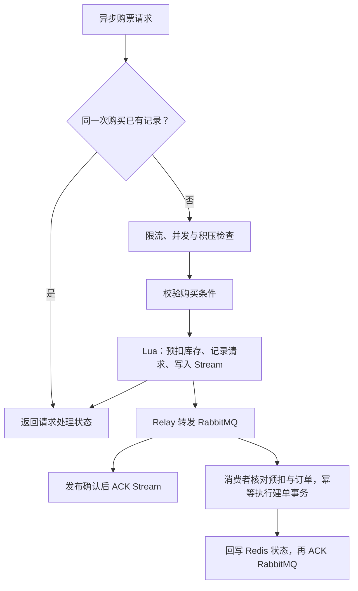
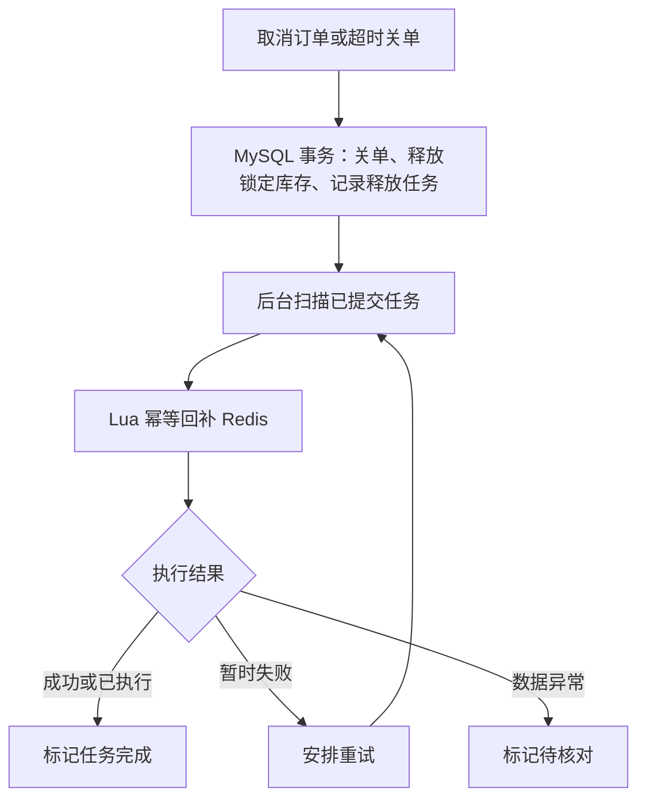

# 仿大麦

基于 Spring Boot、MySQL、Redis 和 RabbitMQ 的票务后端项目，支持演出管理、异步抢票、订单管理和库存回补。

## 技术栈

| 技术 | 用途 |
| --- | --- |
| Java 17、Spring Boot 4.0.8 | 后端开发 |
| Spring Security、Spring Session Redis | 登录会话、角色权限、CSRF 防护 |
| MyBatis-Plus 3.5.17、MySQL 8.4 | 业务数据、订单与库存事务 |
| Redis 7.4、Lua | 库存预扣、请求记录、缓存与限流 |
| Redis Stream、RabbitMQ | 建单任务登记、消息转发与消费 |
| JUnit、Mockito | 单元测试与集成测试 |

## 已实现功能

### 用户与票务管理

- [x] 用户注册、登录、退出，管理员登录与初始化。
- [x] Redis 保存登录会话，用户与管理员权限隔离、本人订单访问控制。
- [x] 演出分类、演出上架与下架、场次启售与停售。
- [x] 票档管理、购买资料缓存、库存预热与撤销预热。

### 异步抢票与订单

- [x] Lua 原子执行库存预扣、购买请求记录和 Stream 任务登记。
- [x] Relay 发布确认后 ACK Stream，支持 Pending 任务恢复。
- [x] 通过请求标识、数据库唯一约束和 MySQL Guard 处理重复请求、消息重投与补偿资格。
- [x] Guard、MySQL 库存锁定和订单创建在同一事务中提交，Redis 状态回写后确认消费消息。
- [x] 订单列表、详情、按请求标识查询、取消、模拟支付和超时关单。

### 抢票入口保护

- [x] 用户级、票档级令牌桶限流。
- [x] 当前 Java 实例的新购买并发名额控制。
- [x] Redis Stream 和 RabbitMQ 积压保护，积压下降后恢复受理。

### 库存释放与异常处理

- [x] 关单、MySQL 库存释放和回补任务记录在同一事务中完成。
- [x] 后台扫描任务，Lua 幂等回补 Redis，支持失败重试和异常待核对。
- [x] 建单失败后的补偿资格申请与幂等回补基础服务。
- [x] 死信消息对账、Redis 状态修复及无法确认消息的暂存。

## 压力测试

使用 **Apache JMeter 5.6.3 非 GUI 模式**，10,000 个独立账号集中抢购 500 张票，每人随机购买 1～6 张；同时持续访问登录身份、订单列表和演出列表。本轮在**后端重启后**执行。

| 指标 | 本轮结果 |
| --- | --- |
| 已受理购买 / 查询确认订单 | **150 / 150** |
| 已确认购买的请求票数合计 | **500 张** |
| 受理成功响应 P95 | **1,540 ms** |
| 全部购票响应 P95 | **3,872 ms** |
| 购票连接失败 / 读取超时 / HTTP 500 | **0 / 0 / 0** |
| 普通访问 | **4,521 次均为 HTTP 200**；抢票期间 P95 为 **3,674 ms** |

其余购票请求中，9,242 次被限流或过载保护拒绝，608 次返回库存不足。已受理购买全部查询到订单。

测试日期：2026-11-09。本地单实例，后端与压测器同机运行并复用连接。P95 为 HTTP 响应耗时；票数按已确认购买的请求数量汇总。[测试环境、完整结果与排查记录](docs/load-test.md)。

## 业务流程

### 异步抢票



购票入口为 `POST /user/orders/async`。返回 `PROCESSING` 表示已受理，随后通过 `GET /user/orders/by-request?requestId=...` 查询订单。

每次新购买使用新的小写 UUID，同一次购买重试复用原 `requestId` 和购买参数。暂未查到订单不代表购买失败。

！！！同步下单入口保留作学习对比，当前业务以异步抢票为主！！！

### 取消与超时关单



待支付订单通常保留 15 分钟，最晚不超过演出开始时间。MySQL 关单与 Redis 回补异步完成，释放任务重复执行不会重复增加库存。

## 项目结构

| 模块 | 职责 |
| --- | --- |
| [common](src/main/java/com/example/damai/common) | 配置、认证、异常与统一响应 |
| [admin](src/main/java/com/example/damai/modules/admin)、[user](src/main/java/com/example/damai/modules/user) | 管理员与用户账户 |
| [program](src/main/java/com/example/damai/modules/program) | 演出、分类、场次 |
| [ticket](src/main/java/com/example/damai/modules/ticket) | 票档、缓存、库存与释放任务 |
| [order](src/main/java/com/example/damai/modules/order) | 订单、受理保护、消息与补偿 |

## 本地启动

### 环境准备

准备 JDK 17、Maven、MySQL、Redis 和启用 Management 插件的 RabbitMQ。

创建 `damai` 数据库并准备项目表结构。初始化 SQL、测试数据和 Compose 示例尚未整理进仓库。

### 连接配置

配置位于 [application.yml](src/main/resources/application.yml)，通过环境变量覆盖：

| 环境变量 | 默认值 |
| --- | --- |
| `DB_HOST` / `DB_PORT` | `127.0.0.1` / `3306` |
| `DB_NAME` / `DB_USERNAME` | `damai` / `root` |
| `DB_PASSWORD` | 必填 |
| `REDIS_HOST` / `REDIS_PORT` | `127.0.0.1` / `6379` |
| `REDIS_PASSWORD` | 空 |
| `RABBITMQ_HOST` / `RABBITMQ_PORT` | `127.0.0.1` / `5672` |
| `RABBITMQ_USER` / `RABBITMQ_PASSWORD` | `damai` / 必填 |
| `RABBITMQ_MANAGEMENT_URL` | `http://127.0.0.1:15672` |

IDEA 运行配置中的环境变量示例，替换密码和实际连接地址：

```text
DB_PASSWORD=your-mysql-password;RABBITMQ_PASSWORD=your-rabbitmq-password;RABBITMQ_MANAGEMENT_URL=http://127.0.0.1:15672;RABBITMQ_INIT_ON_STARTUP=true
```

RabbitMQ 应用账号需提前创建，并具备队列声明、读写和 Management 查询权限。AMQP 与 Management HTTP 地址分别配置。

### 管理员初始化

首次启动时，将以下配置追加到 IDEA 已有的环境变量中：

```text
ADMIN_BOOTSTRAP_ENABLED=true;ADMIN_BOOTSTRAP_USERNAME=admin;ADMIN_BOOTSTRAP_PASSWORD=change-this-admin-password
```

用户名为 4～30 位小写字母、数字或下划线；密码为 12～64 个字符且不超过 72 字节。初始化完成后，将 `ADMIN_BOOTSTRAP_ENABLED` 设为 `false`。

管理员登录接口为 `POST /admin/auth/login`。

### RabbitMQ 配置

`RABBITMQ_INIT_ON_STARTUP=true` 用于启动时声明交换机、队列和绑定。正常转发与建单消费者默认开启，死信恢复消费者通过 `ORDER_RECOVERY_ENABLED=true` 启用。

为正常建单队列 `damai.order.create.queue` 配置死信策略：交换机 `damai.order.dlx`，路由键 `order.create.failed`。队列定义见 [RabbitMqConfig](src/main/java/com/example/damai/common/config/RabbitMqConfig.java)。

### 启动应用

在 IDEA 中运行 `com.example.damai.DamaiApplication`，默认端口 `8080`。终端启动时，先在终端设置相同的环境变量，再执行：

```bash
mvn spring-boot:run
```

注册、登录和写请求需要先调用 `GET /auth/csrf`，保留 Session Cookie，并以返回的 `headerName` 为请求头名称、`token` 为值。

库存需在场次待开售或停售时，通过 `POST /admin/ticket-categories/{id}/stock/warmup` 预热，再将场次启售。

## 测试与打包

单元测试示例：

```bash
mvn -Dtest=OrderCreateMessageTest,TicketStockReservationAsyncServiceTest test
```

全量 `mvn test` 包含依赖中间件和专用测试数据的集成用例，需要先准备测试环境。


```bash
mvn -DskipTests clean package
java -jar target/fang-damai-0.0.1-SNAPSHOT.jar
```

## 后续任务

### 本阶段收尾

- [ ] 补齐数据库初始化 SQL、索引和基础测试数据。
- [ ] 提供 Compose 与环境变量示例。
- [x] 整理 JMeter 压测结果与排查记录。
- [ ] 归档压测脚本与演示流程。

### 后续扩展

- [ ] 验证多个后端同时运行时的受理上限、任务处理，以及单个后端停止后的任务接管。
- [ ] 接入真实支付。
